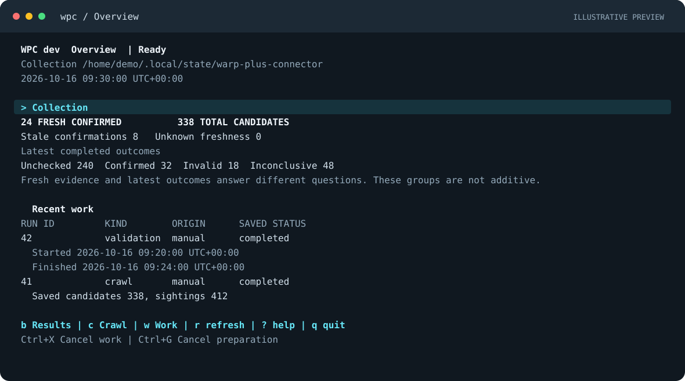
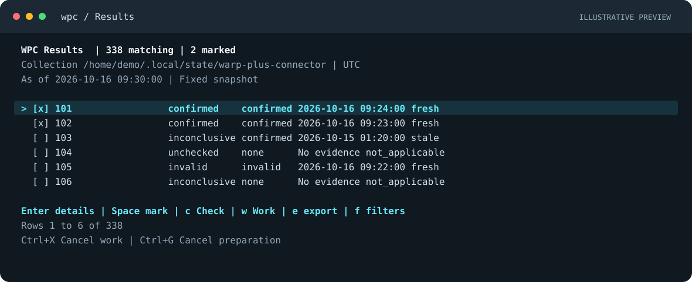
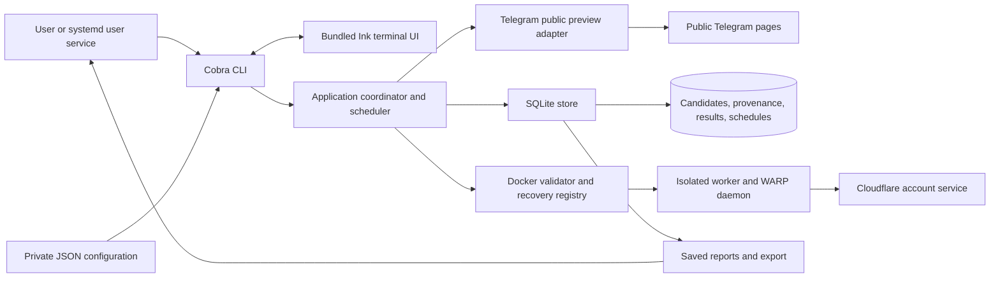

# Warp Plus Connector

[](https://github.com/nguyen-duc-loc/warp-plus-connector/actions/workflows/ci.yml)
[](https://github.com/nguyen-duc-loc/warp-plus-connector/releases)


**Your WARP Plus collection, in one terminal. Collect, check, browse, and export.**

Warp Plus Connector (`wpc`) is a personal CLI for Linux amd64 and arm64. It reads public Telegram previews without a Telegram account, saves discovered keys in a private SQLite database, and validates selected candidates with isolated Docker workers. You can inspect results, export keys, or leave collection and validation running on a schedule.



*Illustrative terminal preview with synthetic data, not live entitlement evidence. Colors depend on your terminal theme.*

**[Explore the terminal UI](#terminal-ui) · [Install WPC](#installation) · [Get a confirmed key](#get-a-confirmed-key) · [Run continuously](#run-continuously)**

WPC answers **“Which collected keys were recently confirmed as Unlimited?”** It does not generate subscriptions, guarantee that a shared key will remain available, apply a key to your device, or connect a WARP tunnel. You apply a selected key yourself. Validation uses a temporary container registration and does not reuse your host WARP registration.

## Contents

- [Installation](#installation)
- [Terminal UI](#terminal-ui)
- [Get a confirmed key](#get-a-confirmed-key)
- [Run continuously](#run-continuously)
- [Commands](#commands)
- [Understand the results](#understand-the-results)
- [Background service](#background-service)
- [Architecture](#architecture)
- [Main algorithm](#main-algorithm)
- [Technology](#technology)
- [Troubleshooting](#troubleshooting)
- [Configuration reference](docs/configuration.md)
- [Local development](docs/development.md)
- [CI and releases](docs/releasing.md)

## Installation

### Download a release

Choose a published version from [GitHub Releases](https://github.com/nguyen-duc-loc/warp-plus-connector/releases).

| Asset | Use |
| --- | --- |
| `warp-plus-connector_<version>_linux_amd64.tar.gz` | Linux on x86_64 CPUs |
| `warp-plus-connector_<version>_linux_arm64.tar.gz` | Linux on aarch64/arm64 CPUs |
| `checksums.txt` | SHA256 checksums for the archives |
| `validator-images.txt` | Matching registry image digests for both architectures |

The archive contains `wpc`, its bundled terminal UI runtime under `lib/`, and documentation. **No Go, Node, pnpm, Git, or repository clone is needed.** The overview requires Linux kernel 4.18 or newer and glibc 2.28 or newer. Docker is optional for collection and saved reads, and required for validation. A systemd user manager is needed only for `service` commands.

For terminal installation, use an empty download directory and replace `0.1.0` below with an actual published version. The example does not mean that this release already exists. Stop if a download or checksum check fails.

```sh
WPC_VERSION=0.1.0
case "$(uname -m)" in
  x86_64) WPC_ARCH=amd64 ;;
  aarch64|arm64) WPC_ARCH=arm64 ;;
  *) echo "Unsupported architecture" >&2; exit 1 ;;
esac

archive="warp-plus-connector_${WPC_VERSION}_linux_${WPC_ARCH}.tar.gz"
release_url="https://github.com/nguyen-duc-loc/warp-plus-connector/releases/download/v${WPC_VERSION}"
curl -fLO "$release_url/$archive" || exit 1
curl -fLO "$release_url/checksums.txt" || exit 1
awk -v file="$archive" '$2 == file {print}' checksums.txt | sha256sum --check - || exit 1
WPC_INSTALL_DIR="$HOME/.local/lib/warp-plus-connector/$WPC_VERSION"
mkdir -p "$WPC_INSTALL_DIR"
tar -xzf "$archive" -C "$WPC_INSTALL_DIR"
mkdir -p "$HOME/.local/bin"
ln -sfn "$WPC_INSTALL_DIR/wpc" "$HOME/.local/bin/wpc"
export PATH="$HOME/.local/bin:$PATH"
wpc version
```

Keep `~/.local/bin` on your shell's `PATH` for future terminals. Before the first published release, use the [source build instructions](docs/development.md#build-and-run).

Run bare `wpc` to open the [terminal overview](docs/terminal.md). Keep the complete version directory together. A launcher symlink is supported; copying only the executable retains explicit commands but cannot open the overview. Updating this launcher does not change a service's bound executable.

### Prepare the validator

On the same Linux machine, install Docker Engine and its CLI, and ensure your account can run `docker info`. The executable, daemon, and image must have the same architecture. Only a local Unix Docker socket is supported.

Pull the image for the **same release version** as your binary:

```sh
validator_image="ghcr.io/nguyen-duc-loc/warp-plus-connector/validator:v${WPC_VERSION}"
docker pull "$validator_image"
validator_image_id=$(docker image inspect "$validator_image" --format '{{.Id}}')
```

Docker selects its native architecture. WPC requires the complete local `sha256:` ID, not a tag, registry URL, or multi architecture manifest reference. Pulling a release image does not require Go or Buildx. The variable belongs to the current terminal; use a [private configuration file](docs/configuration.md) to retain the ID across sessions.

Building your own image is a [development option](docs/development.md#build-the-validator-image). The vendor pin is WARP `2026.8.2110.0`. [Terminal verification](docs/specs/0012-terminal-crawl-check-controls/verify.md#evidence-record) includes a live check and completed remote cleanup recovery with this pin. The candidate returned `not_unlimited`; fresh live Unlimited confirmation remains unverified. CI does not activate real keys.

## Terminal UI

Run **`wpc`** with no subcommand to open the interactive terminal UI. The complete release archive includes its runtime, so you do not need to install Node or pnpm.

```sh
wpc
# Or open a specific profile:
wpc --config /absolute/path/config.json
```

### See your collection at a glance

The overview brings collection totals, fresh confirmations, recent runs, saved schedules, and service observations into one place. It refreshes automatically, with explicit labels for stale or unavailable observations. Opening it only reads saved information; work begins when you choose **Start** in a review.

### Browse, select, and act



*Illustrative Results preview. Candidate IDs, counts, and timestamps are synthetic; keys stay hidden.*

| From the terminal | What you can do |
| --- | --- |
| **Overview** | See collection health, inspect recent work, and read saved schedule and service observations |
| **Results** | Filter by outcome, definitive result, and freshness; browse every matching candidate; mark selections across pages |
| **Candidate details** | Inspect provenance and validation evidence, then explicitly reveal or hide one key |
| **Crawl** | Choose configured sources and page limits, review the request, and start collection |
| **Check** | Review the focused candidate, marked candidates, or all matching candidates before starting Docker validation |
| **Work and reports** | Follow committed progress, cancel work, and inspect saved source coverage and complete validation attempts |
| **Export** | Review a JSON or key file export from a fixed snapshot, with a separate choice to include keys |

Results stay fixed while you browse, even if work saves new data. Refresh to pick up changes. You can keep browsing and prepare an export while a manual operation runs. Existing export files are never overwritten.

### A keyboard journey

1. From Overview, press **`c`** to choose crawl sources, open the review, then select **Start**.
2. Press **`b`** from Overview to browse Results. Use **`f`** for filters and **Space** to mark candidates.
3. Press **`c`** from Results to choose a focused, marked, or matching check. Review the selection and configured policy, then select **Start**.
4. Open **`w`** for work progress. Return to Results and press **`r`** to refresh saved results after completion.
5. Press **Enter** for candidate details and **`k`** to reveal or hide its key, or **`e`** from Results to prepare a reviewed file export.

Docker checks use the validator settings in your [private configuration](docs/configuration.md). Collection and saved reads do not require Docker. Stop an existing runner or service before starting manual work for the same profile.

| Key | Context and action |
| --- | --- |
| `b` / `Esc` | Open Results from Overview / return from Results |
| `c` | Crawl setup from Overview; check selection from Results or details |
| `w` | Open work progress |
| `f` / Space / Enter | Filter Results / mark a candidate / open details |
| `k` / `e` | Reveal or hide a key in details / prepare export from Results |
| Tab / Shift+Tab | Move between sections or fields |
| Arrow keys / Page Up / Page Down | Navigate or scroll the current view |
| `r` / `?` | Refresh the current saved view / open keyboard help |
| Ctrl+X / Ctrl+G | Cancel operational work / cancel preparation independently |
| `q` / Ctrl+C | Quit, with confirmation for active work / interrupt |

The UI requires an actual Linux terminal of at least **60 columns × 16 rows**; **100 or more columns** gives you the wide Results layout. Set `--color never` or `NO_COLOR` for plain styling. Redirected input or output, unsupported platforms, and `TERM=dumb` show root help instead. See the [terminal guide](docs/terminal.md) for installation and runtime details.

## Get a confirmed key

Use this sequence when you want to choose which candidates to validate.

**1. Collect candidates.** This needs access to public Telegram previews, but no Docker configuration:

```sh
wpc sources
wpc crawl --page-limit 2
wpc list --status unchecked
```

Default channels are `warpplus`, `warppluscn`, `warpplushome`, and `warp_veyke`. This example fetches up to two pages from each. A normal `wpc crawl` fetches one page per default channel.

**2. Check selected candidates.** Replace `1 2 3` with IDs from your list:

```sh
wpc check 1 2 3 \
  --validator docker \
  --validator-image "$validator_image_id"
```

**3. Reveal one freshly confirmed key:**

```sh
wpc list --status confirmed --freshness fresh --show-keys --limit 1
```

An empty result means no saved candidate matches those filters. Check more candidates or collect again later. `list` reads saved results; it does not run a validation. Evidence is fresh for six hours by default. Entitlement and device availability may change afterward.

To save all freshly confirmed keys, one per line:

```sh
wpc export --format keys --status confirmed --freshness fresh --output confirmed-keys.txt
```

Named exports create a private file and refuse to overwrite an existing destination. CLI keys remain hidden unless you explicitly use `--show-keys` or `--format keys`. In the terminal UI, key reveal and export disclosure are separate explicit choices.

## Run continuously

After installing the binary and preparing its image, you can skip manual collection and checking:

```sh
wpc run --validator docker --validator-image "$validator_image_id"
```

**`run` both collects candidates and checks their Unlimited entitlement.** It maintains independent crawl and validation schedules.

| Work | Default |
| --- | --- |
| Crawl configured channels | Every hour |
| Recheck definitive results | Every six hours |
| Retry eligible failed work | After one hour |
| Concurrent validation workers | Two |
| Maximum attempts per candidate in one batch | Three |

In another terminal:

```sh
wpc list --status confirmed --freshness fresh --show-keys
wpc schedule show
```

Press **Ctrl+C** in the runner terminal to stop gracefully. Data and schedules survive restarts. A running profile holds the single writer lock; stop it before a manual `crawl` or `check`. Saved reads remain available.

For collection without validation:

```sh
wpc run --validation-enabled=false
```

Use `--crawl-enabled=false` with Docker settings for validation alone. Both lanes cannot be disabled. `--crawl-interval`, `--recheck-interval`, and `--failure-interval` accept `1m` through `720h` in `run`. See [configuration](docs/configuration.md) for persistent settings and custom channels.

## Commands

Use `wpc <command> --help` for flags. Candidate IDs come from `list`; run IDs come from crawl and check reports.

| Command | Description |
| --- | --- |
| `wpc` | Open the interactive terminal overview on a supported Linux terminal |
| `wpc --help` | Show help without reading configuration, opening state, or contacting the network |
| `wpc version` | Show binary version and source commit |
| `wpc sources` | Show configured channels and effective page limits without crawling |
| `wpc crawl` | Fetch bounded public previews and save candidates and provenance |
| `wpc crawl show <run-id>` | Read saved crawl progress and coverage |
| `wpc check <candidate-id>...` | Validate the complete selected set through the configured backend |
| `wpc check show <run-id>` | Read saved policy, results, and every attempt without Docker |
| `wpc list` | List every matching saved candidate, hiding keys by default |
| `wpc export` | Export JSON summaries or exact key lines to stdout or a new file |
| `wpc run` | Continuously collect and validate according to saved schedules |
| `wpc schedule show [candidate-id]` | Explain saved scheduling and eligibility facts |
| `wpc validator recover` | Reconcile retained validation sessions without a new registration |
| `wpc service install --config <path>` | Install and enable a systemd user service for the next login |
| `wpc service start` / `stop` / `restart` | Control current service execution |
| `wpc service enable` / `disable` | Control future login startup without changing current execution |
| `wpc service status` | Report native service, runner, and saved work observations |
| `wpc service logs` | Read bounded logs; `--follow` follows later entries |
| `wpc service doctor` | Inspect configuration, service, state, and Docker without repairs |
| `wpc service uninstall` | Remove a stopped service while retaining configuration, state, and logs |

Examples:

```sh
wpc crawl --source warpplus --source warppluscn --page-limit 3
wpc list --status unchecked,inconclusive --limit 25
wpc list --definitive confirmed --freshness stale
wpc export --output candidates.json
wpc schedule show 1 --format json
wpc check 1 2 --workers 2 --max-attempts 3 \
  --validator docker --validator-image "$validator_image_id"
```

`--source` selects configured enabled channels; it cannot add a channel. `list` and `export` have no default result limit. Values within a filter are alternatives; different filters must all match. `--status` examines the latest outcome; `--definitive` examines the last definitive result. JSON exports use schema version 1. Omit `--output` for stdout; `--output -` is not supported.

## Understand the results

| Outcome | Meaning |
| --- | --- |
| `unchecked` | No completed validation is saved |
| `confirmed` | Matching Unlimited evidence was observed and temporary registration cleanup was proven |
| `invalid` | A definitive rejection was recorded |
| `inconclusive` | The attempt could not establish a definitive result |

A matching Free account produces `not_unlimited`. A full account produces `device_limit`. Both are inconclusive. Temporary failures do not become invalid results. Inconclusive attempts preserve earlier definitive evidence, so `LATEST` and `LAST_DEFINITIVE` can differ. Prefer `--status confirmed --freshness fresh` when selecting a key from recent successful checks.

Results use stdout; diagnostics, completion summaries, and run logs use stderr. Ordinary failures and inconclusive checks exit 1. A definitive invalid result is data and can exit 0, so exit status alone does not mean Unlimited. Reading a historical failed run exits 0 if the read succeeds. SIGINT and SIGTERM request cancellation and use exit codes 130 and 143.

## Background service

Use a systemd user service to run independently of your terminal. Install `wpc` at a stable path and create a private JSON configuration with your source, schedule, and validator settings. The [configuration example](docs/configuration.md) uses collection alone; enable Docker there for automatic checks.

```sh
chmod 600 /absolute/path/config.json
wpc service install --config /absolute/path/config.json
wpc service start
wpc service status
wpc service logs --lines 100 --follow
```

Installation enables startup at the next login but does not start work immediately. WPC does not configure boot services or Linux lingering. `stop` preserves login startup; `disable` does not stop current work. Stop following logs with Ctrl+C without stopping the service.

```sh
wpc service doctor --format json
wpc service stop
wpc service uninstall
```

Settings are reread on start. Changing a bound executable, configuration, state, or Docker path requires a stopped uninstall and new installation. Logs retain at most 20 MiB across five private files. `status` may succeed while reporting an unhealthy service; `doctor` exits 1 for failed checks.

## Architecture



One process owns database writes for a profile. Other processes can read saved results. The application coordinates HTTP, worker capacity, retries, and persistence. Database transactions never span network requests. Separate shared validator ownership prevents profiles from independently attaching keys when remote cleanup is uncertain.

| Package | Responsibility |
| --- | --- |
| `cmd/wpc`, `internal/cli` | Process exit, signals, command parsing, and output |
| `internal/config` | Defaults, private JSON, and explicit flag overrides |
| `internal/app` | Crawl, validation, scheduling, and shutdown coordination |
| `internal/state` | Domain records independent of CLI, HTTP, and SQL drivers |
| `internal/store` | SQLite persistence, migrations, snapshots, and history |
| `internal/source/telegram` | Bounded retrieval, page parsing, and exact extraction |
| `internal/validator`, `cmd/wpc-worker` | Isolated checks, attributable evidence, and remote recovery |
| `internal/service` | systemd user controls, status, logs, and diagnostics |
| `internal/terminal`, `ui` | Bundled Ink interface, private protocol, reviewed actions, and terminal supervision |
| `internal/diagnostic` | Safe structured events, console presentation, and diagnostic failure handling |

## Main algorithm

1. **Resolve settings.** Apply defaults, private JSON, then explicitly supplied flags. Validate the complete selection before opening state or doing external work.
2. **Collect and deduplicate.** Save crawl intent, fetch public previews sequentially, validate complete pages, save coverage, then commit messages with exact candidate values and provenance. Recognized keys have three groups of eight ASCII letters or digits, separated by hyphens. Preserve case and deduplicate exact values. Follow validated older page links within the configured budget.
3. **Validate in isolation.** Save selection and policy, reconcile outstanding recovery, and admit up to the worker limit. Each worker creates a temporary registration, attaches one candidate, and reads evidence attributable to that registration and matching key.
4. **Prove cleanup and save.** Confirmation requires Unlimited evidence and proven remote deletion. Unknown cleanup retains recovery state and blocks new attachment. Only classified temporary failures retry, after cleanup and container removal, within attempt and time budgets.
5. **Schedule and read.** Persist future eligibility for independent lanes. After restart, coalesce missed intervals and select due candidates by due time and ID. Listing and export use one consistent snapshot and one freshness evaluation time.

Public previews never establish complete channel history. Retrieval uses a 20 second deadline, a 2 MiB page limit, and at least one second between request starts. Provider throttling stops validation admission and records shared cooldown state.

## Technology

| Technology | Purpose |
| --- | --- |
| Go `1.27.2` | CLI and worker; one module, CGO disabled for release binaries |
| Cobra `1.10.2` | Commands, flags, and help |
| SQLite via `modernc.org/sqlite 1.60.1` | Persistence without a C compiler for release builds |
| goquery `1.13.0`, `x/net 0.58.0` | HTML parsing and candidate extraction |
| zerolog `1.35.1`, go-isatty `0.0.24` | Structured diagnostics and actual terminal destination detection |
| `encoding/json`, `database/sql` | Configuration, evidence, and explicit SQL |
| Ink `7.1.1`, React `19.2.8`, TypeScript `7.0.2` | Interactive terminal views and reviewed crawl, check, and export flows |
| Bundled Node `24.20.0` | Pinned UI runtime shipped in each Linux archive |
| Docker and official WARP `2026.8.2110.0` | Isolated entitlement checks |
| systemd user services | Optional Linux background operation |
| Go testing, Testify `1.11.1`, race detector | Unit, integration, subprocess, and concurrency checks |
| GitHub Actions and GoReleaser `2.18.3` | CI, Linux archives, checksums, and GitHub Releases |
| GitHub Container Registry | Matching versioned validator images |

Exact dependencies are in [go.mod](go.mod), [go.sum](go.sum), [ui/package.json](ui/package.json), and [ui/pnpm-lock.yaml](ui/pnpm-lock.yaml).

## Troubleshooting

| Symptom | Meaning and next step |
| --- | --- |
| `validation_unsupported` | Configure Docker, or disable validation for collection alone |
| `validator_platform_unsupported` | Use matching Linux executable, local Linux daemon, and amd64 or arm64 image |
| `No such image` after a source build | Builder and image store combinations can return an unusable build digest. The updated helper loads the image and resolves its tag to the local ID. Use the current helper or a release image |
| Pinned WARP package was not found | The upstream repository no longer serves that pin. Use a release image or updated source; changing only the Dockerfile leaves runtime checks mismatched |
| GHCR pull is denied | Confirm the release exists and the package is public; public images should not require login |
| `validator_version_mismatch` | Use the matching binary and validator release, then inspect the downloaded image for its local ID |
| `state_not_initialized` | Run `crawl` or start `run` to create saved state |
| `state_busy` | Stop the profile's runner or service before another writer; reads remain available |
| `device_limit` | The account has no free device capacity; the result is inconclusive |
| `not_unlimited` | The observed account was Free, so Unlimited was not confirmed |
| `validation_rate_limited` | The provider throttled validation; allow the saved cooldown to elapse |
| Configuration access error | Check ownership, regular file status, mode `0600`, and no symlink |
| Export destination exists | Choose a new path outside the canonical state directory |
| Output error with `published=true` or `delivered=true` | Publication or stdout delivery already occurred; account for it before retrying |

For `validation_cleanup_pending`, restore the original local Docker environment and request recovery:

```sh
wpc validator recover --validator docker --validator-image "$validator_image_id"
```

Deleting retained containers or journals does not prove remote deletion. Complete pending recovery using its original compatible binary and images before upgrading.

Linux configuration defaults to `~/.config/warp-plus-connector/config.json` and state to `~/.local/state/warp-plus-connector`, honoring `XDG_CONFIG_HOME` and `XDG_STATE_HOME`. State contains complete keys even when output hides them. See [configuration and privacy](docs/configuration.md#state-and-privacy).

## Project records

[Local development](docs/development.md) covers builds, formatting, tests, and image preparation. [CI and releases](docs/releasing.md) explains workflows, tags, permissions, and failed publication recovery. [Architecture contracts](docs/specs/) and [scope](docs/scope/scope.md) retain implementation and verification history.

Automatic key application or rotation, private Telegram access, unlimited historical backfill, a public API or dashboard, notifications, and macOS release artifacts remain outside the product boundary. Publication does not turn pending live provider or service verification into a completed check.
