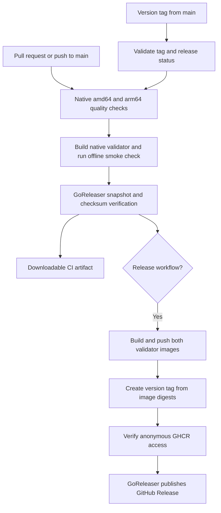

# CI and releases

[Back to the README](../README.md)

GitHub Actions runs the quality gate and packages versioned releases. GoReleaser builds Linux amd64 and arm64 binaries and publishes their archives and checksums to GitHub Releases. Matching validator images are published to GitHub Container Registry (GHCR), so users do not need to clone the project or install Go.

These files configure the automation. They must be merged into the repository before GitHub can run them. A successful local snapshot does not prove that a hosted workflow or public release has run.

## Pipeline overview



### CI workflow

[`.github/workflows/ci.yml`](../.github/workflows/ci.yml) runs for pull requests, pushes to `main` or `feat/**` branches, manual dispatch, and calls from the release workflow.

On native `ubuntu-26.04` (amd64) and `ubuntu-26.04-arm` runners it, using the [supported GitHub runner labels](https://github.com/actions/runner-images):

1. Installs the Go version from `go.mod` and the repository's pinned check tools.
2. Runs formatting, vet, race tests, and lint in the same order as the local gate.
3. Validates workflows with actionlint and runs the native binary's help and version commands.
4. Builds the locked UI tree with bundled Node, runs UI tests, and exercises the package through PTYs on the native host and pinned Debian 10 baseline. The verified trees are passed to archive jobs as artifacts.
5. Builds the native validator image, checks its installed package and worker, and exercises readiness and local cancellation with networking disabled.

When both architectures pass, GoReleaser validates its configuration and creates snapshot archives. CI verifies their checksums and uploads a `linux-snapshot-<commit>` artifact retained for seven days. Two further native jobs extract those final archives and exercise them on Ubuntu 26.04 and the pinned Debian baseline. These are CI artifacts, not public releases or stable version tags.

CI has `contents: read`, uses no publishing credentials, and never runs live Telegram crawls or key attachment. Pull requests from forks use the normal `pull_request` event. There are no path filters that silently skip checks for documentation changes.

### Release workflow

[`.github/workflows/release.yml`](../.github/workflows/release.yml) runs when a `v*` tag is pushed, or when manually dispatched at an existing tag. It refuses dispatch on a branch, malformed versions, tags outside `main` history, and an already published GitHub Release.

Supported tags are:

- Stable: `v0.1.0`, `v1.2.3`.
- Prerelease: `v0.1.0-alpha.1`, `v0.1.0-beta.1`, `v0.1.0-rc.1`.

The workflow reruns CI for the tagged commit. It then builds and smoke checks each native validator, pushes architecture tags, and assembles the shared version tag from the recorded immutable registry digests. It verifies that the images can be inspected without login before GoReleaser publishes the binary release. No floating `latest` image tag is updated.

| Output | Example |
| --- | --- |
| amd64 archive | `warp-plus-connector_0.1.0_linux_amd64.tar.gz` |
| arm64 archive | `warp-plus-connector_0.1.0_linux_arm64.tar.gz` |
| Checksums | `checksums.txt` |
| Image digest record | `validator-images.txt` |
| Shared image tag | `ghcr.io/nguyen-duc-loc/warp-plus-connector/validator:v0.1.0` |
| Native image tags | `.../validator:v0.1.0-amd64`, `.../validator:v0.1.0-arm64` |

Archives include the CLI, the matching bundled Node and UI tree, licenses, and user documentation. Final snapshot checks verify every UI payload digest and directory path. The worker is distributed inside the image. Version and commit metadata come from the tag and Git commit. GoReleaser marks prerelease tags as prereleases and generates a changelog from commit history. Local archive rehearsals first prepare both UI targets using the [terminal packaging commands](terminal.md#local-packaging).

## One time repository setup

1. Enable GitHub Actions and allow the actions referenced by the workflows. Action dependencies are pinned to commit SHAs. The Ubuntu arm64 runner requires availability for this repository; GitHub provides it for public repositories.
2. Allow `GITHUB_TOKEN` to receive the permissions declared by the release jobs. Image publishing uses `packages: write`; GitHub Release publishing uses `contents: write`. No personal access token or custom secret is required for normal publication from this repository.
3. Protect `main` and restrict who can create or update release tags. If you require passing checks, select both native quality jobs and the snapshot job in repository settings. Workflow files alone do not configure branch or tag rules.
4. After GHCR first creates the `warp-plus-connector/validator` package, open its **Package settings** and set **visibility to Public**. Confirm this repository has Actions write access to the package. The source label links the image to this repository.

**GHCR creates new packages as private by default, even when the repository is public.** The first release may therefore stop at the anonymous access check after uploading its images. Make the package public, then rerun the failed publication job. The workflow intentionally avoids publishing a binary release whose matching images still require authentication. See [GitHub's registry documentation](https://docs.github.com/en/packages/working-with-a-github-packages-registry/working-with-the-container-registry#publishing-a-package).

If an organization disallows public packages or hosted arm64 runners, adjust that policy before the first release. Do not remove these checks just to make an incomplete release appear successful.

## Publish a version

After the changes are reviewed and merged into `main`, verify CI and select a new version. Use a prerelease while the live provider or native service checks you require remain pending.

```sh
git switch main
git pull --ff-only origin main
git status --short
git tag -a v0.1.0-rc.1 -m 'WPC 0.1.0 release candidate 1'
git push origin v0.1.0-rc.1
```

The tag push starts publication. The example tag is a maintainer action, not part of installing WPC. Do not reuse a published version or move its tag. For a stable release, use a fresh tag such as `v0.1.0` after the intended verification has passed.

Inspect **Actions → Release**. When it succeeds, check that:

- Both archives, `checksums.txt`, and `validator-images.txt` are attached to the release.
- Each archive contains the expected Linux binary and reports the tagged version.
- The validator tag supports both Linux architectures and can be pulled without authentication.
- The README installation commands work from a clean Linux account.

Publishing does not apply a key or modify a user's WARP installation. Live Unlimited confirmation, remote deletion, systemd login supervision, and fault recovery still require their separate runtime evidence. An offline smoke check proves only the behavior it actually exercises.

## Failed or partial publication

| Failure | Recovery |
| --- | --- |
| Formatting, tests, lint, or snapshot packaging fails | Fix the source, merge it, and use a new tag if source changes are needed |
| The pinned WARP package is unavailable upstream | Keep existing release images; update and verify the pin in source before a new release |
| One architecture image fails to build | No binary release is published; diagnose that runner, then rerun or use a new corrected tag |
| Anonymous GHCR check fails | Set package visibility to Public and rerun the failed job |
| Upload fails before release completion | Inspect the release and uploaded assets; rerun only if it remains unpublished/draft |
| A release is already public | Leave its tag and assets unchanged; issue a new version for corrections |

There is no atomic transaction across GHCR and GitHub Releases. An interrupted run may leave versioned images or a draft release. The workflow serializes each tag and does not cancel a publication already in progress. Different version tags do not share a mutable `latest` image.

To rerun an unpublished tag, use GitHub's failed job rerun or dispatch the Release workflow at that tag. The workflow checks tag ancestry and existing release status again on a full rerun. Do not run a local live `goreleaser release` as a shortcut: it bypasses the workflow's image and public access checks.

## Local rehearsal

```sh
actionlint
goreleaser check
goreleaser release --snapshot --clean
```

This does not push tags, publish images, or create a GitHub Release. It replaces generated `dist/` output and creates both Linux archives. On Linux, verify the generated archive checksums with `(cd dist && sha256sum --check checksums.txt)`. On macOS, use `shasum -a 256 -c checksums.txt` from `dist/`.

Relevant configuration: [GoReleaser](../.goreleaser.yaml), [CI](../.github/workflows/ci.yml), [release workflow](../.github/workflows/release.yml), [image builder](../scripts/validator-image/main.go), and [offline smoke script](../scripts/smoke-validator-image.sh). Reference behavior is documented by [GoReleaser's GitHub Actions guide](https://goreleaser.com/ci/actions/) and [Docker's image loading guide](https://docs.docker.com/build/builders/drivers/).
